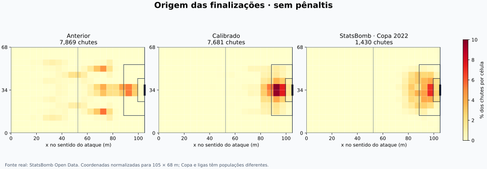

# Validação da calibração espacial v1.3

A calibração corrige a ligação entre jogadas, posições e finalizações. A distância usada no chute passa a vir do campo, os receptores precisam alcançar o espaço pretendido e cabeceios exigem bola aérea. A conclusão estatística sobre proximidade com as ligas está abaixo; o índice do repositório é uma heurística, não uma porcentagem de acerto do futebol real.

## Amostras e versão congelada

- **300 partidas novas em cada versão**, sementes 114000–114299, pareadas por equipes, atributos, estilo, mando e semente. Nenhuma falha foi excluída; as duas versões completaram todas as 300 partidas.
- Referência agregada: **5.329 jogos reais**, cinco ligas, três temporadas. Referência espacial: **1.430 chutes sem pênaltis**, 64 jogos da Copa 2022, incluindo prorrogações quando existentes. A comparação espacial descreve outra população; o motor foi avaliado em tempo regulamentar.
- Desenvolvimento: pilotos 108000–108599 e primeira coorte pareada 112000–112599, arquivada em [round1/REPORT.md](round1/REPORT.md). A primeira revisão regrediu no índice agregado e não foi promovida. A revisão final foi congelada antes de ler a coorte 114000–114299. O modelo geométrico usou 48 partidas StatsBomb para ajuste e 16 para diagnóstico; esse diagnóstico foi consultado no desenvolvimento, portanto não é teste final intocado.
- Runtime anterior: `1908af7`. Runtime congelado publicado: [`f93a445`](https://github.com/adrible/amiguinhos-match-engine/commit/f93a4458f2915eccedb188705cb2027855adbccb). Cabeçalhos brutos registram o commit publicado; árvore e hashes estão em [build_manifest.json](build_manifest.json). Nenhuma alteração do runtime após abrir a coorte final.
- A semente oficial permaneceu em quarentena. `main`, o runtime estável v1.2 e o snapshot anterior de congelamento não foram modificados.

A revisão usa circulação com fator 0,96, intercepto contextual fixo de +0,14 no logit do xG e probabilidade de primeiro amarelo ×1,16. Esses parâmetros foram ajustados com a rodada 1. O motor continua resolvendo probabilidades por lance; o xG contextual resultante não é o modelo proprietário StatsBomb.

## Totais e resultados

| Parâmetro | Real | Anterior | Calibrado |
| --- | --- | --- | --- |
| Gols/jogo | 2.83 | 2.87 | 2.81 |
| Chutes/jogo | 25.27 | 26.41 | 25.78 |
| No alvo/jogo | 8.88 | 8.82 | 8.72 |
| Faltas/jogo | 23.84 | 23.43 | 23.30 |
| Escanteios/jogo | 9.69 | 9.88 | 9.78 |
| Amarelos/jogo | 4.14 | 3.57 | 3.98 |
| Vermelhos/jogo | 0.19 | 0.18 | 0.19 |
| Gols mandante/jogo | 1.55 | 1.47 | 1.44 |
| Gols visitante/jogo | 1.28 | 1.40 | 1.37 |
| Vitórias mandante | 43.6% | 41.7% | 37.0% |
| Empates | 25.2% | 25.7% | 27.7% |
| 0–0 | 6.1% | 7.3% | 6.3% |
| Ambos marcam | 54.9% | 55.0% | 58.0% |
| Mais de 2,5 gols | 53.5% | 53.3% | 51.3% |

Índice agregado do repositório: **91.04 → 86.84**. Variação observada: -4.21 pontos; IC95% por 1.000 reamostragens pareadas de partidas: **[-13.65; +11.61]**. O intervalo inclui zero: não demonstra melhora estatística do índice.

| Mudança pareada por partida | Média | IC95% aproximado |
| --- | --- | --- |
| goals | -0.060 | [-0.317; +0.197] |
| shots | -0.623 | [-1.301; +0.054] |
| sot | -0.097 | [-0.567; +0.374] |
| home_goals | -0.027 | [-0.206; +0.153] |
| away_goals | -0.033 | [-0.217; +0.150] |
| home_win | -0.047 | [-0.122; +0.028] |
| draw | +0.020 | [-0.049; +0.089] |

Os intervalos agrupam os lances por partida; chutes de uma mesma partida não são tratados como observações independentes. As referências reais são fixas neste benchmark; a incerteza de escolha de campeonato/temporada não está nesses intervalos.

## De onde saem os chutes

| Medida espacial — sem pênaltis | StatsBomb | Anterior | Calibrado |
| --- | --- | --- | --- |
| Distância média (m) | 16.03 | 37.43 | 16.35 |
| Distância mediana (m) | 15.44 | 36.04 | 14.74 |
| Dentro da área | 64.8% | 18.7% | 69.7% |
| Chutes acima de 35 m | 0.3% | 53.4% | 3.5% |
| Cabeceios / chutes | 17.6% | 17.0% | 13.1% |
| Distância média de cabeceios (m) | 8.74 | 36.92 | 9.95 |
| xG médio por chute | 0.096 | 0.101 | 0.108 |

| Distância | StatsBomb | Anterior | Calibrado |
| --- | --- | --- | --- |
| 0-6 | 5.6% | 0.6% | 3.9% |
| 6-12 | 28.6% | 9.3% | 29.8% |
| 12-18 | 27.3% | 11.6% | 32.1% |
| 18-24 | 23.4% | 6.1% | 21.0% |
| 24-35 | 14.8% | 19.0% | 9.8% |
| 35-120 | 0.3% | 53.4% | 3.5% |

Anterior: distância de Wasserstein da distribuição real = **21.39 m**; diferença máxima entre distribuições acumuladas (KS) = **0.653**. São tamanhos de diferença, não índices universais de realismo.
Calibrado: distância de Wasserstein da distribuição real = **1.14 m**; diferença máxima entre distribuições acumuladas (KS) = **0.055**. São tamanhos de diferença, não índices universais de realismo.

| Origem do motor | n anterior | n novo | m anterior | m novo | xG novo | Conversão nova |
| --- | --- | --- | --- | --- | --- | --- |
| carry | 124 | 111 | 46.75 | 16.00 | 0.094 | 10.8% |
| corner | 889 | 831 | 45.67 | 8.86 | 0.109 | 10.6% |
| cross | 802 | 830 | 20.38 | 16.69 | 0.098 | 11.3% |
| cutback | 760 | 717 | 21.70 | 16.21 | 0.156 | 14.1% |
| dribble | 200 | 194 | 38.45 | 14.70 | 0.116 | 13.9% |
| dummy | 14 | 12 | 40.62 | 16.10 | 0.114 | 8.3% |
| free_kick | 168 | 170 | 33.82 | 26.12 | 0.084 | 9.4% |
| open_play | 2615 | 2569 | 39.89 | 18.90 | 0.069 | 5.6% |
| progression | 460 | 463 | 40.49 | 15.71 | 0.102 | 8.2% |
| quick_free_kick | 186 | 168 | 32.01 | 16.20 | 0.104 | 9.5% |
| rebound | 206 | 194 | 52.07 | 13.62 | 0.148 | 14.9% |
| second_ball | 165 | 169 | 50.62 | 17.26 | 0.101 | 8.9% |
| through_ball | 1154 | 1119 | 40.66 | 14.40 | 0.180 | 19.0% |
| transition | 126 | 134 | 51.03 | 24.72 | 0.055 | 2.2% |

As categorias do motor não são uma tradução exata das categorias do provedor. Comparações auxiliares de entregas reais:
| Assistência StatsBomb | n | Distância média (m) | xG médio |
| --- | --- | --- | --- |
| cross | 244 | 9.98 | 0.133 |
| cutback | 29 | 10.75 | 0.152 |
| freekick | 46 | 24.89 | 0.043 |

Pênaltis têm um resolvedor separado e não entram nesses mapas nem nos grupos por chute. Contagem/conversão geral aparece nos totais; a origem XYZ e a trajetória de cada pênalti ainda precisam de uma auditoria própria.

## Corpo, pressão e qualidade da chance

| Corpo — calibrado | n | Distância média (m) | No alvo | Conversão | xG médio |
| --- | --- | --- | --- | --- | --- |
| head | 1010 | 9.95 | 39.9% | 9.0% | 0.092 |
| left_foot | 1476 | 17.49 | 28.6% | 8.1% | 0.105 |
| right_foot | 5195 | 17.28 | 33.5% | 11.3% | 0.112 |

Referência de cabeceios da Copa: 252 chutes, 8.74 m, 30.6% no alvo, 11.1% convertidos. Não confundir com a referência anterior da Premier League 2019–24, outra população e período.

| Pressão do motor — calibrado | n | Distância média (m) | Bloqueados | No alvo | Conversão | xG |
| --- | --- | --- | --- | --- | --- | --- |
| 0-0.33 | 965 | 19.32 | 18.0% | 35.0% | 9.7% | 0.094 |
| 0.33-0.66 | 4952 | 16.30 | 22.5% | 34.1% | 10.9% | 0.118 |
| 0.66-1.01 | 1764 | 14.88 | 18.4% | 30.4% | 9.2% | 0.088 |

Esses estratos são descritivos: pressão, distância, origem e habilidade variam juntos. A comparação causal de pressão foi feita separadamente no experimento de sensibilidade.

| Faixa de xG — calibrado | n | xG médio | Gols / chutes | No alvo |
| --- | --- | --- | --- | --- |
| 0-0.05 | 2539 | 0.028 | 2.0% | 26.0% |
| 0.05-0.1 | 2105 | 0.073 | 5.8% | 33.0% |
| 0.1-0.2 | 1968 | 0.140 | 13.2% | 36.5% |
| 0.2-0.4 | 903 | 0.274 | 32.1% | 44.9% |
| 0.4-1.01 | 166 | 0.490 | 46.4% | 51.2% |

No diagnóstico real de 16 partidas, o modelo geométrico previu xG médio 0.0935, contra 0.0937 da StatsBomb; erro absoluto médio por chute **0.0386**. Isso mede proximidade com as estimativas do provedor, não acerto de resultado de cada chute. Finalizador e goleiro não entram no xG geométrico; entram na execução.

Com o ajuste contextual aplicado, a média nas mesmas 16 partidas é 0.1041, com MAE 0.0414 para o xG do provedor. Esse aumento é um compromisso explícito da calibração de contexto; a correspondência bruta anterior não deve ser apresentada como resultado do motor já ajustado.

## Desvios concretos ainda presentes

A distribuição espacial melhorou muito; a validação não demonstrou melhora global do índice. O candidato permanece em revisão, sem promoção ao runtime principal.

- **Cauda de distância:** 3.5% dos chutes novos ultrapassam 35 m, contra 0.3% na referência. Há 266 casos: 73 de through_ball, 60 de cross, 53 de cutback, 28 de free_kick, 28 de transition e 24 de outras origens. O caso extremo foi uma tentativa de falta a 105,01 m (semente 114000, xG 0,001, fora do alvo). O excesso em assistências aponta para decisões de finalização/receptores ainda resolvidas sem alcance suficiente; exige um teste próprio da recepção e do local da reposição, sem cortar distâncias apenas para ajustar um histograma.
- **Resultados/mando:** vitória do mandante em 37.0% dos jogos, contra 43.6% nas ligas. A diferença pareada para o runtime anterior tem intervalo amplo e inclui zero. Os controles pequenos mostram efeito positivo do mando, mas não comprovam a magnitude correta; o benefício de mando não está validado globalmente por esta amostra.
- **Cabeceios:** 39.9% no alvo e 9.0% convertidos, contra 30.6% e 11.1% na Copa. Diferenças de situação e população exigem comparação por distância, pressão e tipo de entrega, além da média geral.
- **Altura:** o contato simulado de cabeça ainda tem alvo fixo de 1,6 m. A consistência Z foi testada; a distribuição de alturas e impulsão ainda não foi validada com tracking real.

## Integridade e testes

- 600 partidas completas na validação final: 300 anteriores + 300 revisadas, sementes 114000–114299, sem falhas nem exclusão de resultados. A primeira rodada de desenvolvimento reteve outras 1.200 partidas comparativas em round1/.
- Código da revisão congelado no commit f93a445 antes da coorte final; os três lotes registram os mesmos parâmetros 0,14 / 0,96 / 1,16 e o hash da classe carregada. Nenhuma mudança de runtime durante a validação.
- Paridade do observador por igualdade completa do estado e RNG em uma partida inteira de cada versão.
- Ledger completo, IDs de chutes únicos e soma de xG consistente em todas as partidas das duas rodadas.
- 849 testes aprovados na suíte final da revisão. Um teste histórico v1.2 foi explicitamente excluído, pois a mesma falha de assinatura _choose_target(action) foi reproduzida no commit anterior. Evidência em test_results.txt; o código estável não foi alterado.
- 85 testes direcionados de coordenadas, contato, disciplina, arbitragem e mando também aprovados; 15 testes específicos de geometria/contato/alcance/persistência/tracking e 25 de coordenadas integram a suíte.
- 20.000 execuções contrafactuais (20 cenários × 1.000) da revisão: nove relações causais aprovadas para distância, pressão, ângulo, habilidade e goleiro. A habilidade muda a execução sem alterar a qualidade geométrica da chance.
- 240 trajetórias de bola da revisão, nenhuma falha em gravidade/solo ou ponto final; 20 retomadas durante o voo com estado idêntico. Teste de consistência, não comparação com tracking real de bola.
- 96 jogos usados no controle de mando desta comparação: 24 sementes × dois modos × duas versões. Os 48 jogos da versão anterior foram reutilizados da rodada 1; foram produzidos 144 jogos distintos de controle ao todo.
- Cenários antigos de chute na área e disputa de rebote receberam posições físicas coerentes; as mesmas asserções de dificuldade e qualidade de reação foram mantidas.
- Sincronização de posse corrigida: o ponto da bola dominada acompanha o jogador registrado como dono ao fim do passo público; o novo teste verifica também o evento retornado.

| Verificação espacial | Anterior | Calibrado |
| --- | --- | --- |
| Chute rotulado área fora da área física | 3991 | 0 |
| Cabeceio com contato abaixo de 0,5 m | 1304 | 0 |
| Jogador fora dos limites / não finito | 0 | 0 |
| Bola XYZ inválida | 0 | 0 |
| Dono da bola fora de campo | 0 | 0 |
| Bola dominada a mais de 2 m do dono | 0 | 0 |
| Violação do limite de deslocamento observado | 0 | 0 |

O antigo contador `shot_distance_proxy_gap_over_10m` permanece nos dados brutos como diagnóstico da aproximação por setor; deixou de ser erro do resolvedor novo, que usa a distância física. `used_distance_error` verifica a distância efetivamente informada ao chute. Altura simulada de contato de cabeça ainda é um alvo simplificado de 1,6 m; tracking externo fornece sua própria altura.

## Estilos, força e mando

| Diferença de força — calibrado | n | Gols/jogo | Chutes/jogo | Vitória mandante |
| --- | --- | --- | --- | --- |
| similar | 281 | 2.82 | 25.79 | 37.7% |
| home_stronger | 9 | 3.22 | 24.44 | 55.6% |
| away_stronger | 10 | 2.10 | 26.70 | 0.0% |

Todos os cruzamentos de estilos estão em `summary.json`. Os cinco mais frequentes, escolhidos por tamanho de amostra:
| Estilo mandante / visitante | n | Gols/jogo | Chutes/jogo |
| --- | --- | --- | --- |
| balanced / balanced | 36 | 2.67 | 24.83 |
| balanced / attacking | 22 | 2.91 | 25.18 |
| defensive / balanced | 22 | 2.18 | 23.77 |
| balanced / direct | 20 | 2.55 | 26.45 |
| direct / balanced | 20 | 3.35 | 26.45 |

Controles adicionais com os mesmos elencos de força 80 e estilo equilibrado, sementes 113100–113123 em cada modo:
**Anterior**

| Modo | n | Gols equipe 0 | Gols equipe 1 | Acréscimo 2ºT anunciado (min) | Acréscimo 2ºT jogado (min) |
| --- | --- | --- | --- | --- | --- |
| neutral | 24 | 1.50 | 1.12 | 6.38 | 7.70 |
| home_away | 24 | 1.21 | 1.12 | 6.42 | 7.77 |

**Calibrado**

| Modo | n | Gols equipe 0 | Gols equipe 1 | Acréscimo 2ºT anunciado (min) | Acréscimo 2ºT jogado (min) |
| --- | --- | --- | --- | --- | --- |
| neutral | 24 | 1.00 | 1.42 | 6.46 | 7.88 |
| home_away | 24 | 1.29 | 1.04 | 6.38 | 7.86 |

São só 24 jogos por modo e versão; diferenças pequenas não demonstram viés de mando. Tempo público, tempo bruto e acréscimo anunciado são medidas diferentes. Não se compara o número de eventos abstratos de passe com passes completos de tracking.

## Onde testar e desenvolver a seguir

1. **Chutes extremos e qualidade por assistência:** reduzir as caudas ainda divergentes de distância/ângulo sem impor quotas; validar cruzamentos, passes em profundidade e rebotes com uma liga completa, incluindo pressão e posição do goleiro no instante do chute.
2. **Impedimento geométrico:** posição da bola, penúltimo defensor, corredor e instante do passe. O impedimento atual ainda depende do modelo probabilístico por setor.
3. **Movimento contínuo:** aceleração, frenagem, curvas e sprint por jogador; o limite atual de deslocamento de 8 m/s não representa picos de velocidade de elite. Deslocamento entre eventos não equivale a velocidade instantânea medida por tracking.
4. **Contato aéreo e colisões:** altura individual, impulsão, tempo do salto, disputa, bloqueio corporal, quique, arrasto e recepção após a bola cair. O voo atual usa gravidade e velocidade horizontal constante; a altura de contato simulada ainda é simplificada.
5. **Posse e passe completos:** registrar cada recepção, domínio, perda, pressão e linha de passe antes de comparar volume, acerto, progressão e duração de posse com eventos reais. O motor atual agrega circulação em batidas de tempo.
6. **Fadiga e contexto:** pressão alta contra bloco baixo, superioridade numérica, 120 minutos, substituições, chuva e estado do placar; testes pareados com atributos idênticos e apenas uma intervenção de cada vez. O estudo atual tem estratos descritivos de estilo/força, não estima isoladamente todos esses efeitos.

## Fontes e reprodução

Dados espaciais: **StatsBomb Open Data**, disponibilizados para pesquisa pela StatsBomb/Hudl. [Repositório e termos](https://github.com/statsbomb/open-data), [marca oficial](https://www.hudl.com/en_gb/products/statsbomb), [media pack](https://statsbomb.com/media-pack/). Ícone original da página oficial, preservado em `statsbomb_icon.svg`; direitos da marca pertencem ao titular. Conversão 120×80 → 105×68 não é metragem física observada do estádio.

Referência agregada: [Football-Data.co.uk](https://www.football-data.co.uk/data.php), [mirror datasets/football-datasets](https://github.com/datasets/football-datasets), fontes e hashes em `summary.json`. Geometria: [IFAB, Lei 1](https://www.theifab.com/laws/latest/the-field-of-play/).

Scripts: `build_shot_reference.py`, `run_audit.py`, `run_sensitivity.py`, `run_controls.py`, `run_physics_controls.py`, `summarise.py`, `make_report.py`. Os seis arquivos `realism-before/after-*.json.gz` retêm as amostras completas, sem seleção. Os hashes dos eventos reais usados no ajuste estão em `data/spatial_shot_reference_v13.json`. Veja [README.md](README.md) para os comandos básicos.
