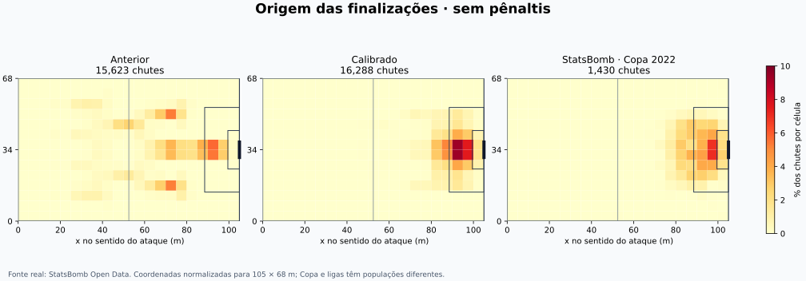

# Rodada 1 — geometria melhor, candidato reprovado para promoção

**Resultado da rodada:** candidato `6e8bbeb` retido como experimento. Índice agregado 90,57 → 80,67; IC95% da diferença inclui zero. Os excessos de eventos e 13 inconsistências de posse justificaram nova calibração. Esta coorte foi incorporada ao desenvolvimento da rodada 2; não é validação independente da revisão posterior.

A calibração corrige a ligação entre jogadas, posições e finalizações. A distância usada no chute passa a vir do campo, os receptores precisam alcançar o espaço pretendido e cabeceios exigem bola aérea. A conclusão estatística sobre proximidade com as ligas está abaixo; o índice do repositório é uma heurística, não uma porcentagem de acerto do futebol real.

## Amostras e versão congelada

- **600 partidas novas em cada versão**, sementes 112000–112599, pareadas por equipes, atributos, estilo, mando e semente. Nenhuma falha foi excluída; não houve escolha de resultados. As duas versões completaram todas as 600 partidas.
- Referência agregada: **5.329 jogos reais**, cinco ligas, três temporadas. Referência espacial: **1.430 chutes sem pênaltis**, 64 jogos da Copa 2022, incluindo prorrogações quando existentes. A comparação espacial descreve outra população; o motor foi avaliado em tempo regulamentar.
- Parâmetros ajustados apenas nos pilotos 108000–108599. Coorte 112000–112599 lida depois do congelamento. O modelo geométrico usou 48 partidas StatsBomb para ajuste e 16 para diagnóstico; esse diagnóstico foi consultado durante o desenvolvimento e não é um teste final intocado.
- Runtime anterior: `1908af7`. Runtime congelado publicado: [`6e8bbeb`](https://github.com/adrible/amiguinhos-match-engine/commit/6e8bbeb2eed65635d89c141e4c482aadae879211). Cabeçalhos brutos registram o build local equivalente `ea76d9b`; identidade exata da árvore e hashes estão em [build_manifest.json](build_manifest.json). Nenhuma alteração do runtime após abrir a coorte final.
- A semente oficial permaneceu em quarentena. `main`, o runtime estável v1.2 e o snapshot anterior de congelamento não foram modificados.

## Totais e resultados

| Parâmetro | Real | Anterior | Calibrado |
| --- | --- | --- | --- |
| Gols/jogo | 2.83 | 2.78 | 2.68 |
| Chutes/jogo | 25.27 | 26.20 | 27.31 |
| No alvo/jogo | 8.88 | 8.90 | 9.40 |
| Faltas/jogo | 23.84 | 24.00 | 25.18 |
| Escanteios/jogo | 9.69 | 9.69 | 10.59 |
| Amarelos/jogo | 4.14 | 3.75 | 3.76 |
| Vermelhos/jogo | 0.19 | 0.21 | 0.19 |
| Gols mandante/jogo | 1.55 | 1.50 | 1.50 |
| Gols visitante/jogo | 1.28 | 1.28 | 1.17 |
| Vitórias mandante | 43.6% | 41.2% | 45.3% |
| Empates | 25.2% | 27.2% | 25.0% |
| 0–0 | 6.1% | 8.7% | 7.3% |
| Ambos marcam | 54.9% | 52.7% | 49.8% |
| Mais de 2,5 gols | 53.5% | 51.5% | 49.2% |

Índice agregado do repositório: **90.57 → 80.67**. Variação observada: -9.90 pontos; IC95% por 1.000 reamostragens pareadas de partidas: **[-20.39; +1.83]**. O intervalo inclui zero: não demonstra melhora estatística do índice.

| Mudança pareada por partida | Média | IC95% aproximado |
| --- | --- | --- |
| goals | -0.100 | [-0.288; +0.088] |
| shots | +1.115 | [+0.640; +1.590] |
| sot | +0.500 | [+0.166; +0.834] |
| home_goals | +0.003 | [-0.131; +0.137] |
| away_goals | -0.103 | [-0.237; +0.030] |
| home_win | +0.042 | [-0.011; +0.095] |
| draw | -0.022 | [-0.069; +0.026] |

Os intervalos agrupam os lances por partida; chutes de uma mesma partida não são tratados como observações independentes. As referências reais são fixas neste benchmark; a incerteza de escolha de campeonato/temporada não está nesses intervalos.

## De onde saem os chutes

| Medida espacial — sem pênaltis | StatsBomb | Anterior | Calibrado |
| --- | --- | --- | --- |
| Distância média (m) | 16.03 | 37.25 | 16.41 |
| Distância mediana (m) | 15.44 | 36.10 | 14.71 |
| Dentro da área | 64.8% | 19.2% | 70.0% |
| Chutes acima de 35 m | 0.3% | 53.7% | 3.9% |
| Cabeceios / chutes | 17.6% | 16.6% | 14.4% |
| Distância média de cabeceios (m) | 8.74 | 37.27 | 9.74 |
| xG médio por chute | 0.096 | 0.101 | 0.095 |

| Distância | StatsBomb | Anterior | Calibrado |
| --- | --- | --- | --- |
| 0-6 | 5.6% | 0.7% | 4.4% |
| 6-12 | 28.6% | 9.2% | 30.2% |
| 12-18 | 27.3% | 12.3% | 31.4% |
| 18-24 | 23.4% | 5.5% | 20.4% |
| 24-35 | 14.8% | 18.7% | 9.7% |
| 35-120 | 0.3% | 53.7% | 3.9% |

Anterior: distância de Wasserstein da distribuição real = **21.22 m**; diferença máxima entre distribuições acumuladas (KS) = **0.653**. São tamanhos de diferença, não índices universais de realismo.
Calibrado: distância de Wasserstein da distribuição real = **1.20 m**; diferença máxima entre distribuições acumuladas (KS) = **0.053**. São tamanhos de diferença, não índices universais de realismo.

| Origem do motor | n anterior | n novo | m anterior | m novo | xG novo | Conversão nova |
| --- | --- | --- | --- | --- | --- | --- |
| carry | 237 | 223 | 45.26 | 15.74 | 0.093 | 8.5% |
| corner | 1675 | 1950 | 45.86 | 8.61 | 0.103 | 10.1% |
| cross | 1650 | 1737 | 20.16 | 16.87 | 0.085 | 9.8% |
| cutback | 1475 | 1483 | 21.84 | 17.58 | 0.124 | 12.5% |
| dribble | 395 | 363 | 42.66 | 14.83 | 0.107 | 11.8% |
| dummy | 42 | 31 | 39.97 | 14.41 | 0.113 | 9.7% |
| free_kick | 382 | 357 | 34.00 | 28.66 | 0.076 | 7.3% |
| open_play | 5281 | 5389 | 39.68 | 18.65 | 0.063 | 5.7% |
| progression | 918 | 980 | 40.87 | 16.00 | 0.090 | 9.1% |
| quick_free_kick | 337 | 379 | 32.30 | 15.41 | 0.097 | 9.5% |
| rebound | 402 | 434 | 50.15 | 14.09 | 0.125 | 11.1% |
| second_ball | 338 | 357 | 48.14 | 17.40 | 0.096 | 10.9% |
| through_ball | 2249 | 2314 | 40.48 | 14.89 | 0.155 | 15.3% |
| transition | 242 | 291 | 49.81 | 23.31 | 0.053 | 6.2% |

As categorias do motor não são uma tradução exata das categorias do provedor. Comparações auxiliares de entregas reais:
| Assistência StatsBomb | n | Distância média (m) | xG médio |
| --- | --- | --- | --- |
| cross | 244 | 9.98 | 0.133 |
| cutback | 29 | 10.75 | 0.152 |
| freekick | 46 | 24.89 | 0.043 |

Pênaltis têm um resolvedor separado e não entram nesses mapas nem nos grupos por chute. Contagem/conversão geral aparece nos totais; a origem XYZ e a trajetória de cada pênalti ainda precisam de uma auditoria própria.

## Corpo, pressão e qualidade da chance

| Corpo — calibrado | n | Distância média (m) | No alvo | Conversão | xG médio |
| --- | --- | --- | --- | --- | --- |
| head | 2338 | 9.74 | 39.6% | 8.6% | 0.086 |
| left_foot | 2958 | 17.61 | 29.9% | 7.8% | 0.093 |
| right_foot | 10992 | 17.51 | 33.9% | 10.0% | 0.098 |

Referência de cabeceios da Copa: 252 chutes, 8.74 m, 30.6% no alvo, 11.1% convertidos. Não confundir com a referência anterior da Premier League 2019–24, outra população e período.

| Pressão do motor — calibrado | n | Distância média (m) | Bloqueados | No alvo | Conversão | xG |
| --- | --- | --- | --- | --- | --- | --- |
| 0-0.33 | 1973 | 19.92 | 17.6% | 39.1% | 8.1% | 0.083 |
| 0.33-0.66 | 10439 | 16.55 | 22.5% | 34.0% | 9.8% | 0.102 |
| 0.66-1.01 | 3876 | 14.24 | 18.6% | 31.7% | 9.0% | 0.084 |

Esses estratos são descritivos: pressão, distância, origem e habilidade variam juntos. A comparação causal de pressão foi feita separadamente no experimento de sensibilidade.

| Faixa de xG — calibrado | n | xG médio | Gols / chutes | No alvo |
| --- | --- | --- | --- | --- |
| 0-0.05 | 6157 | 0.027 | 2.4% | 27.3% |
| 0.05-0.1 | 4684 | 0.073 | 6.7% | 35.2% |
| 0.1-0.2 | 3668 | 0.140 | 14.4% | 38.7% |
| 0.2-0.4 | 1538 | 0.269 | 28.8% | 44.6% |
| 0.4-1.01 | 241 | 0.478 | 41.5% | 46.9% |

No diagnóstico real de 16 partidas, o modelo geométrico previu xG médio 0.0935, contra 0.0937 da StatsBomb; erro absoluto médio por chute **0.0386**. Isso mede proximidade com as estimativas do provedor, não acerto de resultado de cada chute. Finalizador e goleiro não entram no xG geométrico; entram na execução.

## Integridade e testes

- 1.200 partidas completas na coorte final: 600 anteriores + 600 calibradas; nenhuma falha excluída, mesma população e sementes pareadas.
- Paridade do observador verificada por igualdade completa do estado e RNG em uma partida inteira de cada versão.
- Ledger de chutes: cobertura completa, IDs únicos e soma de xG consistente em cada uma das 1.200 partidas.
- 20.000 execuções contrafactuais de finalização (20 cenários × 1.000): distância, pressão, ângulo, habilidade, goleiro e corpo; nove relações causais verificadas.
- 240 trajetórias de bola: gravidade/solo consistentes, pontos finais finitos e 20 retomadas durante o voo com estado idêntico.
- 96 partidas adicionais de controle de mando: 24 sementes × dois modos × duas versões; amostra pequena, sem seleção de resultados.
- 14 testes novos de geometria, contato, alcance, tracking externo, persistência, simetria e validade de estados; 25 testes de coordenadas.
- 848 testes aprovados na suíte final da primeira rodada, excluindo somente um teste histórico v1.2 com falha já reproduzida na versão anterior. 30 testes do núcleo/loader/persistência também aprovados.
- Um teste histórico v1.2 foi excluído da suíte final: test_engine_v12.StableV12Tests.test_same_seed_remains_reproducible. O mesmo erro foi reproduzido no commit anterior: assinatura _choose_target não aceita action. O runtime estável foi preservado.
- Cenários antigos de chute na área e de disputa de rebote foram atualizados para colocar os jogadores fisicamente no local declarado; as mesmas asserções de dificuldade e reação foram mantidas.

| Verificação espacial | Anterior | Calibrado |
| --- | --- | --- |
| Chute rotulado área fora da área física | 7728 | 0 |
| Cabeceio com contato abaixo de 0,5 m | 2519 | 0 |
| Jogador fora dos limites / não finito | 0 | 0 |
| Bola XYZ inválida | 0 | 0 |
| Dono da bola fora de campo | 0 | 0 |
| Bola dominada a mais de 2 m do dono | 0 | 13 |
| Violação do limite de deslocamento observado | 0 | 0 |

O antigo contador `shot_distance_proxy_gap_over_10m` permanece nos dados brutos como diagnóstico da aproximação por setor; deixou de ser erro do resolvedor novo, que usa a distância física. `used_distance_error` verifica a distância efetivamente informada ao chute. Altura simulada de contato de cabeça ainda é um alvo simplificado de 1,6 m; tracking externo fornece sua própria altura.

## Estilos, força e mando

| Diferença de força — calibrado | n | Gols/jogo | Chutes/jogo | Vitória mandante |
| --- | --- | --- | --- | --- |
| home_stronger | 32 | 3.06 | 26.84 | 65.6% |
| similar | 548 | 2.65 | 27.30 | 44.5% |
| away_stronger | 20 | 2.90 | 28.35 | 35.0% |

Todos os cruzamentos de estilos estão em `summary.json`. Os cinco mais frequentes, escolhidos por tamanho de amostra:
| Estilo mandante / visitante | n | Gols/jogo | Chutes/jogo |
| --- | --- | --- | --- |
| balanced / balanced | 73 | 2.59 | 26.32 |
| balanced / direct | 43 | 2.81 | 26.84 |
| balanced / attacking | 37 | 2.86 | 26.89 |
| direct / balanced | 36 | 2.47 | 27.64 |
| balanced / defensive | 35 | 2.34 | 24.69 |

Controles adicionais com os mesmos elencos de força 80 e estilo equilibrado, sementes 113100–113123 em cada modo:
**Anterior**

| Modo | n | Gols equipe 0 | Gols equipe 1 | Acréscimo 2ºT anunciado (min) | Acréscimo 2ºT jogado (min) |
| --- | --- | --- | --- | --- | --- |
| neutral | 24 | 1.50 | 1.12 | 6.38 | 7.70 |
| home_away | 24 | 1.21 | 1.12 | 6.42 | 7.77 |

**Calibrado**

| Modo | n | Gols equipe 0 | Gols equipe 1 | Acréscimo 2ºT anunciado (min) | Acréscimo 2ºT jogado (min) |
| --- | --- | --- | --- | --- | --- |
| neutral | 24 | 1.12 | 0.71 | 6.12 | 7.63 |
| home_away | 24 | 1.00 | 0.92 | 5.83 | 7.23 |

São só 24 jogos por modo e versão; diferenças pequenas não demonstram viés de mando. Tempo público, tempo bruto e acréscimo anunciado são medidas diferentes. Não se compara o número de eventos abstratos de passe com passes completos de tracking.

## Onde testar e desenvolver a seguir

1. **Chutes extremos e qualidade por assistência:** reduzir as caudas ainda divergentes de distância/ângulo sem impor quotas; validar cruzamentos, passes em profundidade e rebotes com uma liga completa, incluindo pressão e posição do goleiro no instante do chute.
2. **Impedimento geométrico:** posição da bola, penúltimo defensor, corredor e instante do passe. O impedimento atual ainda depende do modelo probabilístico por setor.
3. **Movimento contínuo:** aceleração, frenagem, curvas e sprint por jogador; o limite atual de deslocamento de 8 m/s não representa picos de velocidade de elite. Deslocamento entre eventos não equivale a velocidade instantânea medida por tracking.
4. **Contato aéreo e colisões:** altura individual, impulsão, tempo do salto, disputa, bloqueio corporal, quique, arrasto e recepção após a bola cair. O voo atual usa gravidade e velocidade horizontal constante; a altura de contato simulada ainda é simplificada.
5. **Posse e passe completos:** registrar cada recepção, domínio, perda, pressão e linha de passe antes de comparar volume, acerto, progressão e duração de posse com eventos reais. O motor atual agrega circulação em batidas de tempo.
6. **Fadiga e contexto:** pressão alta contra bloco baixo, superioridade numérica, 120 minutos, substituições, chuva e estado do placar; testes pareados com atributos idênticos e apenas uma intervenção de cada vez. O estudo atual tem estratos descritivos de estilo/força, não estima isoladamente todos esses efeitos.

## Fontes e reprodução

Dados espaciais: **StatsBomb Open Data**, disponibilizados para pesquisa pela StatsBomb/Hudl. [Repositório e termos](https://github.com/statsbomb/open-data), [marca oficial](https://www.hudl.com/en_gb/products/statsbomb), [media pack](https://statsbomb.com/media-pack/). Ícone original da página oficial, preservado em `statsbomb_icon.svg`; direitos da marca pertencem ao titular. Conversão 120×80 → 105×68 não é metragem física observada do estádio.

Referência agregada: [Football-Data.co.uk](https://www.football-data.co.uk/data.php), [mirror datasets/football-datasets](https://github.com/datasets/football-datasets), fontes e hashes em `summary.json`. Geometria: [IFAB, Lei 1](https://www.theifab.com/laws/latest/the-field-of-play/).

Scripts: `build_shot_reference.py`, `run_audit.py`, `run_sensitivity.py`, `run_controls.py`, `run_physics_controls.py`, `summarise.py`, `make_report.py`. Os oito arquivos `realism-before/after-*.json.gz` retêm as amostras completas, sem seleção. Os hashes dos eventos reais usados no ajuste estão em `data/spatial_shot_reference_v13.json`. Veja [README.md](../README.md) para os comandos básicos.
